#1 Renault-Visteon-Radio
## This repo is dedicated to the reverse engineering and mapping of the OEM Renault Visteon radio found in the Renault Twingo mk2, Clio 3, Scénic 3, among other models. This to make modifications, low-level repairs, or for general curiosity.

The specimen used is from a 2011 Renault Twingo II Phase 1.(Pre-facelift) Part no. 2811 500 31R.

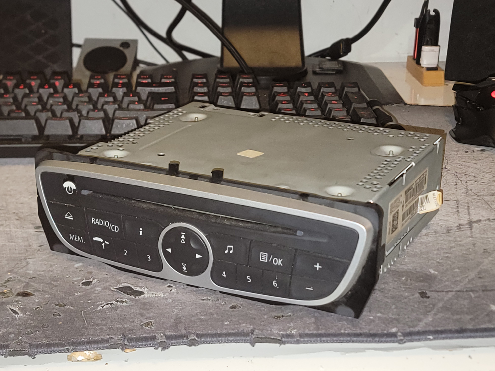
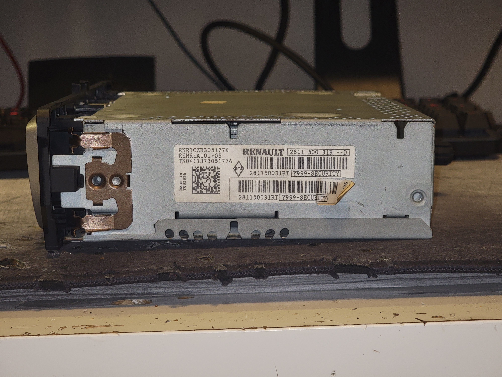

These radio's are commonly found in Renault group products from around the 2010's.
They are compact, decently powered AM/FM/Aux/CD radio's featuring a can-bus interface which usually goes paired with a display near the dashboard/instrument cluster. This version came with an LCD style display; there are also Visteon radios which drive a dot-matrix display. I haven't been able to find one to take apart yet.

## Disassembly 
 This process is easy and well-designed. 

#### 1 - Identify and remove 8 torx T9 screws. a T10 will fit but you need to push hard to prevent slippage.

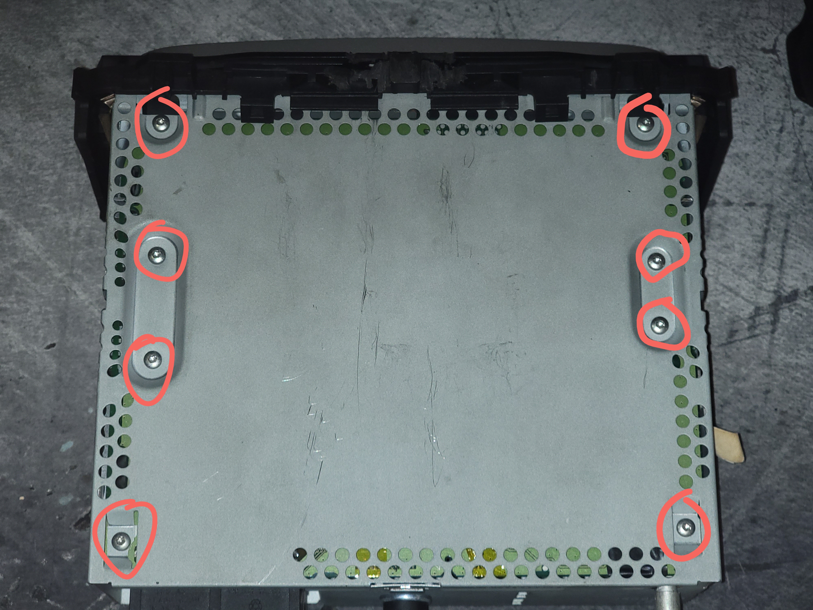

#### 2 - Tilt and pull back cover plate, then tilt and pull back mainboard. 
The mainboard has a push-pull style connector to the front panel. This does NOT have any clips. Just pull away and it will come loose. This design is on purpose. Remove the red CD module cable. This lifts straight up. 

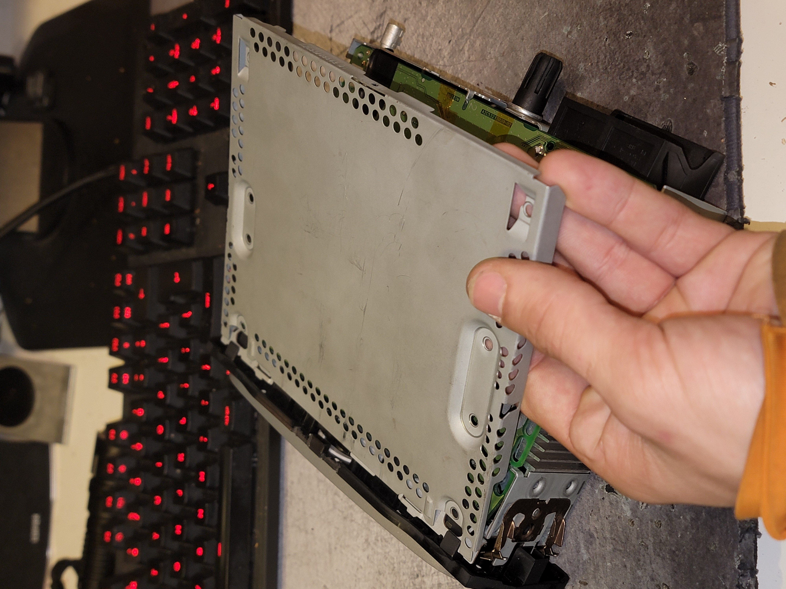
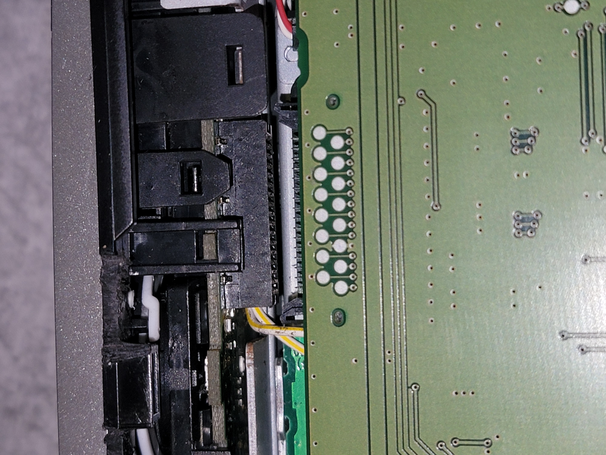
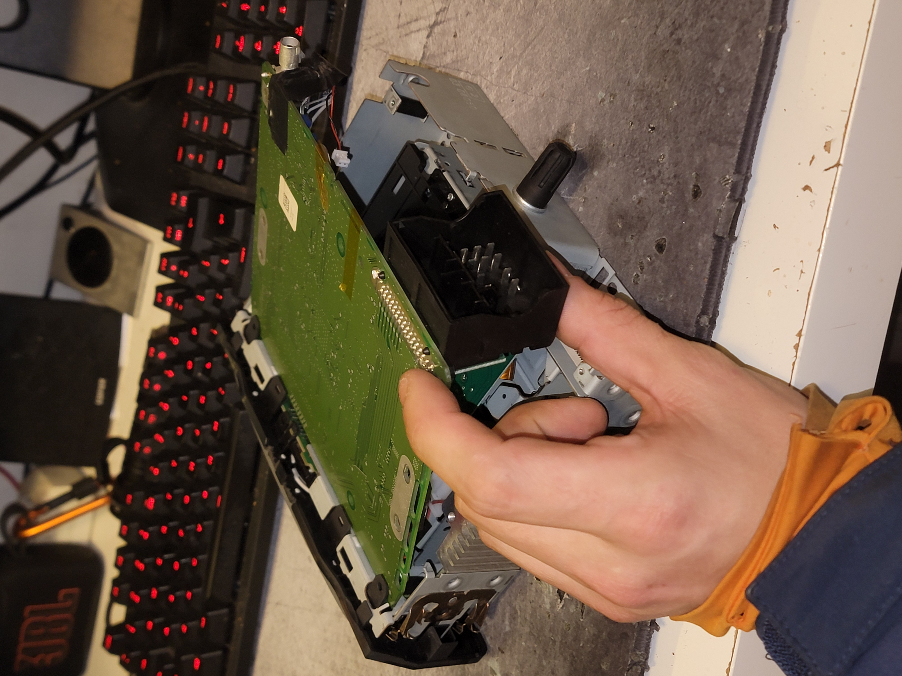
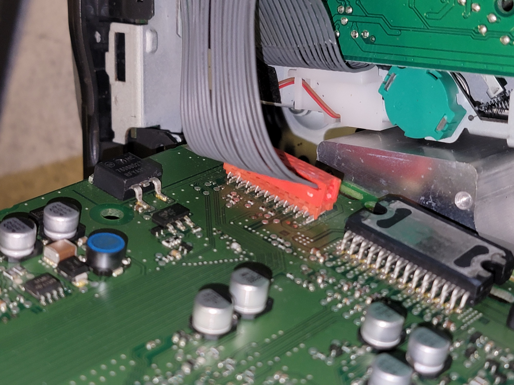

#### 3 - Identify and remove 4 torx T9 screws

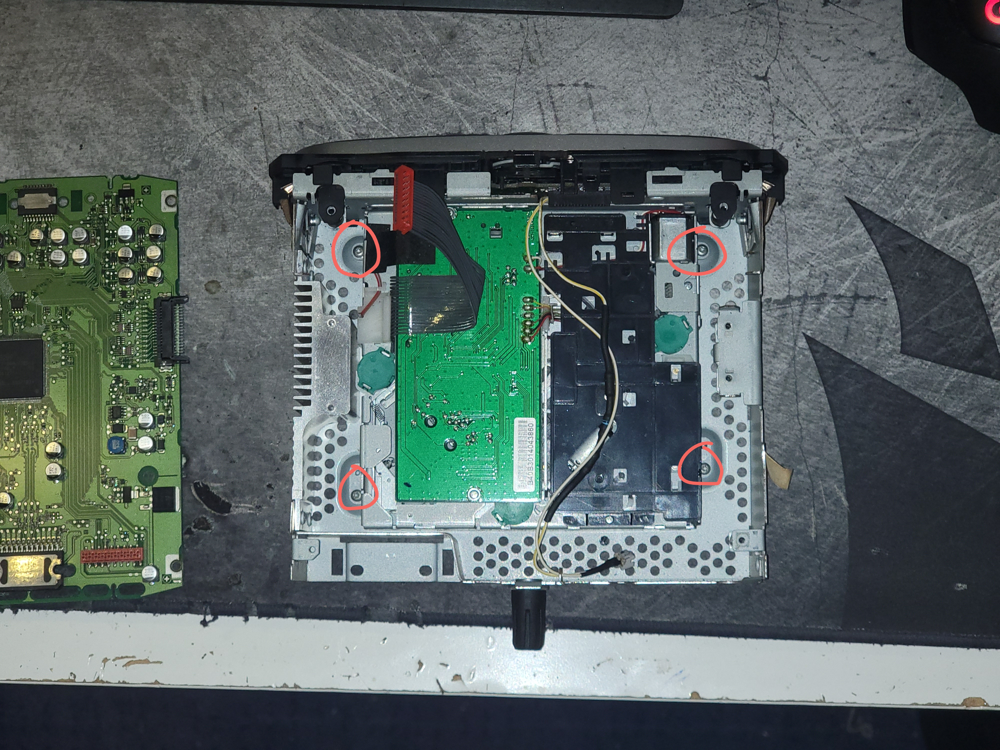

#### 4 - Pull the CD unit sideways, then up and out .

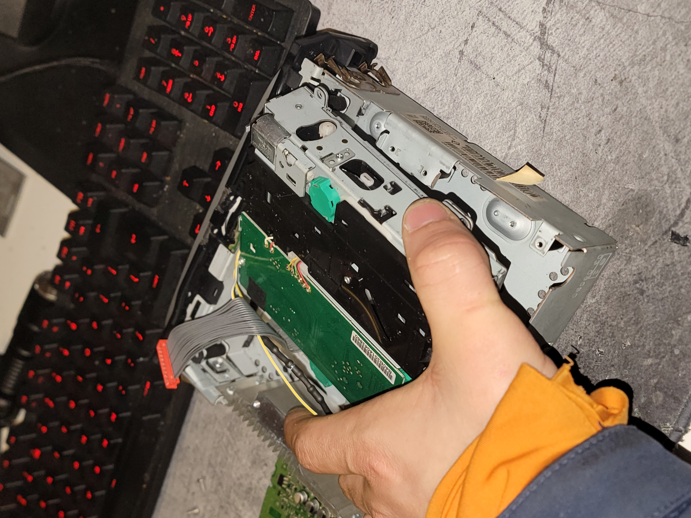

#### 5 - Identify 6 clips

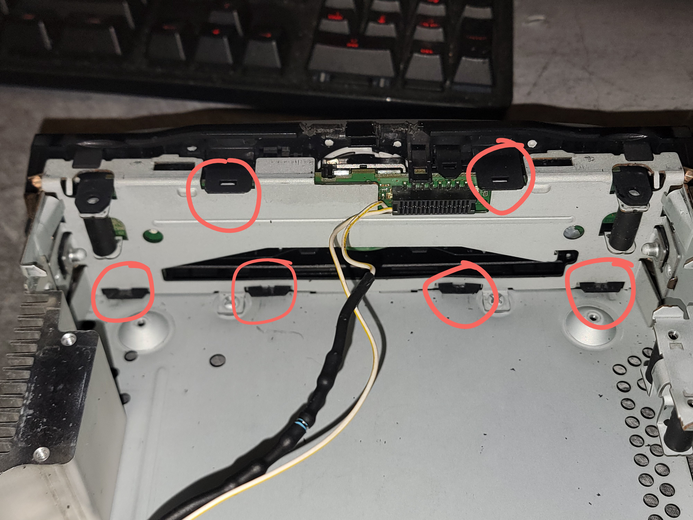

#### 6 - Pull front panel straight off.

# Mainboard

The board has four important chips:

TDA7529 (IF RF front-end, LQFP64 package, top left) - [TDA7529 datasheet](https://www.alldatasheet.com/datasheet-pdf/view/173331/STMICROELECTRONICS/TDA7529.html)

SAF7780HL (Main Soc, LQFP-176 package, middle) - [SAF7741 datasheet](https://www.alldatasheet.com/datasheet-pdf/view/1424867/NXP/SAF7741.html) - Closest match

TDA7563ASM (Amplifier, Flexiwatt27 SMD package, bottom middle) - [TDA7563 datasheet](https://www.alldatasheet.com/datasheet-pdf/view/243592/STMICROELECTRONICS/TDA7563ASM.html)

L5956PD (Regulator IC, PowerSO-20 package, top middle) - [L5956 datasheet](https://www.alldatasheet.com/datasheet-pdf/view/234417/STMICROELECTRONICS/L5956PD.html)

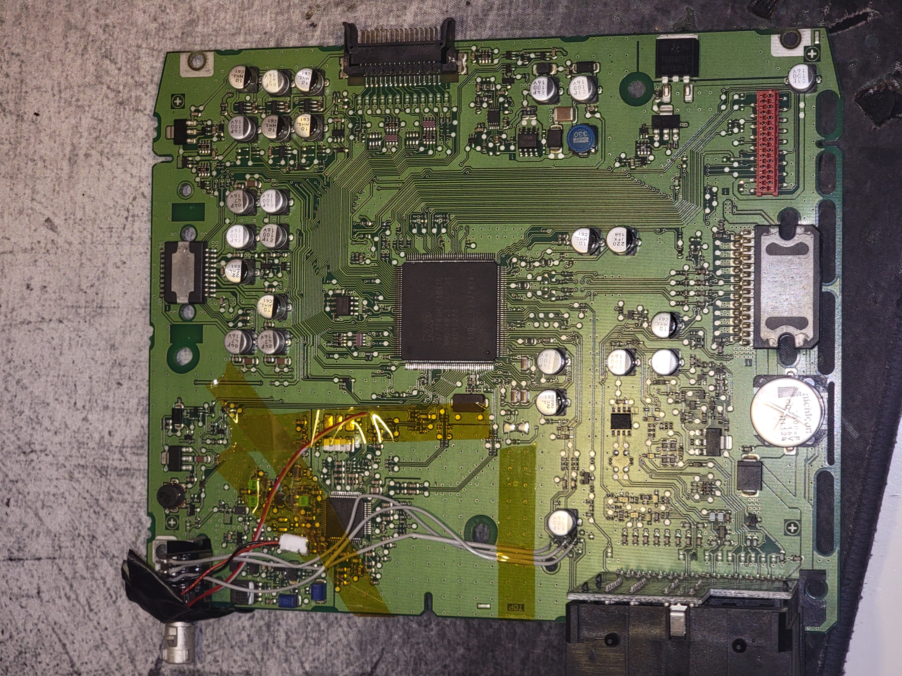
(Left to right: Ground, Left, Right)
